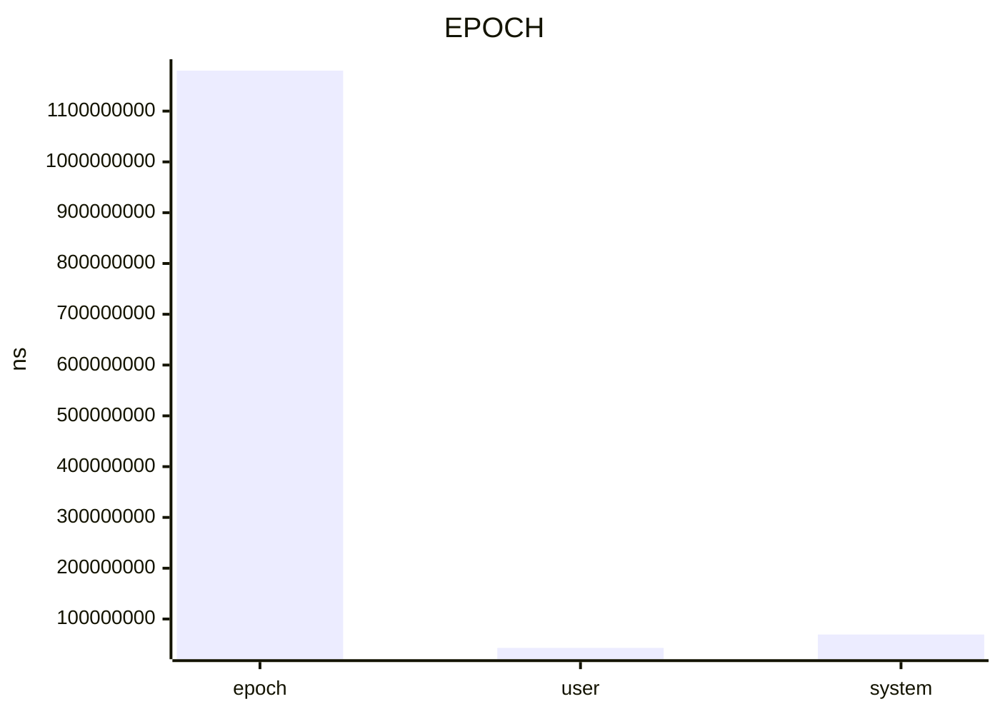

## epoch

+--------+-------+---------------+--------------+---------------+---------------+-------+------+---------------+
| key    | type  | value         | errorPercent | min           | max           | calls | unit | samples       |
+========+=======+===============+==============+===============+===============+=======+======+===============+
| epoch  | float | 1.179783625e9 | 0.0          | 1.179783625e9 | 1.179783625e9 | 1     | ns   | 1.179783625e9 |
+--------+-------+---------------+--------------+---------------+---------------+-------+------+---------------+
| user   | float | 4.2983e7      | 0.0          | 4.2983e7      | 4.2983e7      | 1     | ns   | 4.2983e7      |
+--------+-------+---------------+--------------+---------------+---------------+-------+------+---------------+
| system | float | 6.9433e7      | 0.0          | 6.9433e7      | 6.9433e7      | 1     | ns   | 6.9433e7      |
+--------+-------+---------------+--------------+---------------+---------------+-------+------+---------------+

